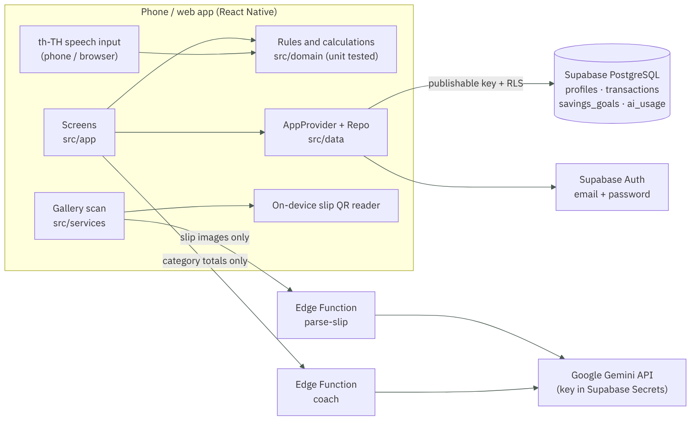

# MindPay · Final Report (M3)

**Team 13. Socrates and Skeletons** · Introduction to Software Engineering (15031001) · 9 November 2026

**Members:** 6931503089 Aoengthai Saesae · 6931503077 Sithikan Potiyun · 6931503072 Witchayapong Lamchaona · 6931503069 Vorachon Srijariyakorn · 6931503055 Patcharapornchai Khapai

References: M1 Team Charter (`docs/M1-team-charter.pdf`), SRS (`Team13_M2_SRS.pdf`), design diagrams (`docs/design/`), demo slides (`slides/MindPay-M3-demo.pdf`)

- **Try it (web, any device):** https://2550expo-tech.github.io/Socrates-and-Skeletons-/
- **Android app (.apk):** https://github.com/2550expo-tech/Socrates-and-Skeletons-/releases/tag/latest-apk

## 1. Problem and users

Smartphone users who pay and get paid through mobile banking several times a week (students and first jobbers on a monthly budget) often put off recording their expenses, because they have to retype details and search for payment slips themselves. Their records end up incomplete and their financial summaries unreliable. They see only their remaining balance, not how fast the money is going, so they cannot adjust their spending before the end of the month.

## 2. Scope of this release

This release delivers **FR-1 to FR-6**, all built and clickable end to end. FR-7 (Accountability Mode) and FR-8 (Online operating mode) from the original M1 Charter and SRS are moved to a later release. The M1 Charter in `docs/` was revised on 9 November 2026 to match this repository; the SRS will be updated the same way.

| FR | Name | Status |
|---|---|---|
| FR-1 | Transaction management | Built |
| FR-2 | Overview dashboard | Built |
| FR-3 | Voice transaction logging | Built |
| FR-4 | Automatic gallery slip detection | Built |
| FR-5 | AI Persona Coach (Nong Kla) | Built (changed at users' request, see section 6) |
| FR-6 | Money Runway / estimated low-balance date | Built |

## 3. Golden Thread: Problem → FR → Design → Prototype → Test

Every row is complete across all five columns. Diagrams are in `docs/design/`. Every screen can be opened from the web link above (sign in → Home).

| Problem | FR | Design (`docs/design/`) | Prototype page (screen / file) | Test |
|---|---|---|---|---|
| Records are incomplete or wrong, so summaries and forecasts cannot be trusted | **FR-1** Add, edit, categorize, delete transactions | `03-er-diagram` (transactions table), `05-seq-fr1-fr2`, `04-screen-flow` | **Add transaction** screen `src/app/transaction.tsx` · **Transactions** tab `src/app/(tabs)/transactions.tsx` | Unit TC-01, TC-02, TC-25, TC-72, TC-79 · E2E "add income ฿1,000" · Manual MT-02, MT-03, MT-10 |
| Separate records make the overall financial status hard to see | **FR-2** Overview of income, expenses, balance, category totals | `05-seq-fr1-fr2`, `04-screen-flow` | **Home** tab `src/app/(tabs)/index.tsx` | Unit TC-03, TC-08, TC-09, TC-10, TC-11, TC-81 · E2E home / new day · MT-02 |
| Manual entry is slow, so users postpone logging and forget | **FR-3** Say "rice 50 baht" → editable draft → save | `06-seq-fr3-voice` | Gold mic button on Home → **Voice** screen `src/app/voice.tsx` | Unit TC-59, TC-60, TC-61, TC-80 · E2E voice (heard → saved) · MT-12 |
| Searching for slips and retyping them is repetitive | **FR-4** Automatic gallery slip detection, 0.80 confidence threshold, duplicate check | `07-seq-fr4-slip`, `03-er-diagram` (slip_ref, slip_image_hash, ocr_confidence), `02-architecture` | **Scan slips** button → `src/app/scan.tsx` · drafts `src/app/drafts.tsx` · auto-scan on app open | Unit TC-19–TC-24, TC-26–TC-30, TC-64, TC-83–TC-88 · E2E scan, auto-scan, QR, offline · MT-04–MT-07, MT-09, MT-11 |
| Charts show numbers but not what to do next | **FR-5** AI coach explains verified data, with a fallback when AI is unavailable | `08-seq-fr5-coach`, `02-architecture` | **Coach** tab (Nong Kla) `src/app/(tabs)/coach.tsx` | Unit TC-31, TC-32, TC-49–TC-51, TC-89 + Edge Function helper tests · E2E coach (AI busy → rule-based summary) · MT-08 |
| A balance does not show how fast money is being spent | **FR-6** Money Runway from the 7-day average daily expense | `09-flow-fr6-runway`, `03-er-diagram` (runway_floor_satang) | **Runway** tab `src/app/(tabs)/runway.tsx` + card on Home | Unit TC-12–TC-18 (`computeRunway`, `averageDailyExpense`; zero average, no division by zero = TC-15) · E2E runway slider · MT-02 |

Per-criterion links from acceptance criteria to code to tests are in `docs/TRACEABILITY.md`.

## 4. Design

| File in `docs/design/` | Shows | FR |
|---|---|---|
| `01-use-case` | The user, UC-1 to UC-6, and external systems (AI, speech recognizer) | All Must FRs |
| `02-architecture` | React Native app → Supabase (Auth, PostgreSQL + RLS, Edge Functions) → Gemini | All FRs |
| `03-er-diagram` | Tables profiles, transactions, savings_goals, ai_usage (from `supabase/migrations`) | FR-1, FR-4, FR-6 |
| `04-screen-flow` | Screen order: welcome → onboarding → 4 tabs → voice / scan / transaction | All FRs |
| `05-seq-fr1-fr2` | Saving a transaction, then Home recalculating totals | FR-1, FR-2 |
| `06-seq-fr3-voice` | Speech → text → parsed entries → user confirms → saved | FR-3 |
| `07-seq-fr4-slip` | Find slip images → on-device QR → parse-slip reads twice → ≥ 0.80 confirmed / lower becomes a draft | FR-4 |
| `08-seq-fr5-coach` | Only totals go to coach → answer, or rule-based summary when AI is unavailable | FR-5 |
| `09-flow-fr6-runway` | Runway formula, zero-average case, below_floor, critical / watch / healthy thresholds | FR-6 |

Each diagram has a Mermaid source (`.mmd`) and a rendered `.png`.

## 5. Testing (latest run 9 November 2026)

| Type | Result |
|---|---|
| Unit tests (`npm test`, Vitest: `src/domain/__tests__`, Edge Function helpers) | **157/157 passed** |
| Browser E2E (`e2e/web-auth.mjs`, Playwright + mock Supabase, light and dark mode) | **146/146 passed** |
| Typecheck (`tsc --noEmit`) and lint (`expo lint`) | Passed |
| Manual tests on real phones MT-01 to MT-12 | Plan in `docs/TRACEABILITY.md`, results to be filled in by the team |

## 6. Changes from the SRS (requested by users) that the SRS must reflect

- **FR-5 (29 Sep):** Users asked to replace the 3-tone coach (Supportive / Direct / Reflective) with "Nong Kla", one friendly voice that can speak aloud. The rules stay: use only verified values, label the message as AI-generated guidance, and show a rule-based summary when AI is unavailable.
- **FR-4 (27 Sep):** A slip whose every field is read with confidence ≥ 0.80 is counted immediately (can be turned off in Settings). Unclear slips stay as drafts.

## 7. Limitations and next steps

- FR-7 Accountability Mode and FR-8 Online operating mode are planned for a later release.
- Reading a slip with AI takes from a few seconds up to about 50 seconds when the second (verifying) model is slow. Planned fix: a shorter time limit for the verifying model.
- Leaked Password Protection should be turned on in Supabase Auth.

## 8. AI use during development

Every use of AI is logged in `docs/AI_USAGE_LOG.md`.
